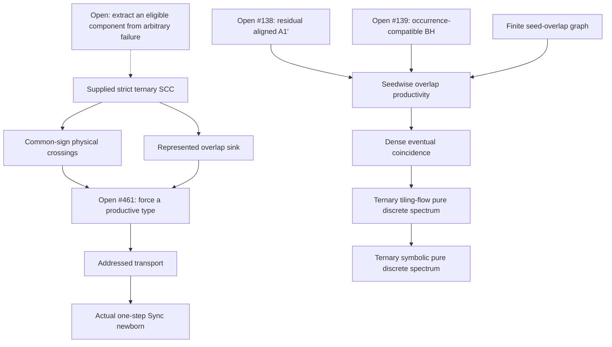

# Mathematical evidence and remaining dependencies

**Snapshot** `fd3b64e2e25a7d8a7a8623a52677a8822e52f6c5`
**Evidence classes** Written proof, finite exact computation, formal proof with explicit premises, and open or proposed implication. “Written proof” identifies a source argument with stated hypotheses. Independent human review is pending.

## Conventions

PIP means primitive substitution with irreducible incidence characteristic polynomial and a Pisot Perron eigenvalue \(\beta>1\). The project route below is on three letters. A state is a literal irreducible balanced pair of nonempty words. Its ordered children are **every** consecutive factor between equal-Parikh prefix cuts of its one-step image, retaining order and multiplicity. A supplied strict component is a finite nonempty strongly connected collection, normalized by track swap where specified, closed under every such child and containing only noncoincident states. A recurrence witness or selected subgraph can have exits.

An overlap is an actual top and bottom source tile with positive-length interior intersection in Perron coordinates. Productivity means that a composable occurrence descent reaches a same-letter tile with the same start on both tracks. A newborn is an interior zero-return cut in the immediate image of an irreducible parent. Its adjacent ordered letters must lie in the repository's right \(\mathrm{Sync}_+\) or left \(\mathrm{Sync}_-\) endpoint-synchronization set. A diagonal on the relevant side already qualifies.

## Written theorems suitable for focused review

| Result and proof location | Exact premises | Conclusion and dependencies |
|---|---|---|
| Run-family theorem, #477/#479/#481 | \(a,b\) nonnegative integers with \(a+b\ge1\), literal forward or reversed substitution as specified in the draft | Simultaneous prefix coincidence in at most four levels. Uses explicit concatenation identities, the cubic/Pisot calculation, and inheritance of balanced cuts. Gives a diagonal from every irreducible balanced pair and excludes strict closure in those families. |
| Parikh rank and integral obstruction, #460/#462 | Ternary incidence with irreducible cubic for the rank-three claim. Actual nonempty balanced root and all ordered factors through depth two. Separately, an integral complete system with \(PN=MP\) and rational rank exactly two for the integral obstruction | The columns of the full depth-zero through depth-two cone span \(\mathbb Q^3\) because their generation sums are \(p,Mp,M^2p\). A proper span would give a proper rational invariant subspace by Cayley–Hamilton. On a closed system, the full-column image of \(P\) is invariant by \(PN=MP\). If its rank is two, a primitive integer normal \(f\) satisfies \(fM=\lambda f\) with \(\lambda\in\mathbb Z\) by primitivity of \(f\). Thus an irreducible cubic excludes that rank. No newborn follows from rank three. |
| Physical hub crossing frequency, #469 | Ternary PIP, positive left Perron lengths, supplied finite strictly all-child-closed SCC, common hub orientation and **one common sign** over every actual ordered child occurrence. Counts use all factors with multiplicity | \(\liminf c_n/r_n\ge \ell_{\min}/(\ell_{\min}+B)>0\), where \(B\) is maximum absolute physical completion area. Uses the weighted degree-two area identity, balanced concatenation, the common sign at every generation, the exterior-square spectral gap, and a Perron lower bound on the number of factors. The passage to a genuine physical overlap uses #466's completion argument. |
| Whole-factor enclosure, #471 | Nonerasing substitution with positive lengths scaled by \(\beta>1\), supplied finite strict closed SCC of literal balanced pairs, track-swap quotient with physical orientations retained | Each actual overlap reaches every represented type in at most \(n+|C|-1\) steps for any \(n\) with \(\beta^n d>2L\). Here \(d\) is the source intersection length and \(L\) the maximum factor length. Bounded cut gaps enclose a whole factor in the inflated intersection, then literal child paths reach a target state. Each descendant overlap belongs to one factor, giving forward closure and hence a sink SCC. At least one zero-offset type is represented at a factor start. |
| Addressed transport, #467 | Nonerasing substitution and literal irreducible noncoincident balanced root. Two valid equal-depth, occurrence-indexed descendant addresses terminate in the same letter with equal full Parikh prefixes | Their ancestors stay in one common balanced factor because inherited cuts separate any split. The first diagonal along the common path has an adjacent interior cut in its immediate parent image, giving an actual \(\mathrm{Sync}_+\) or \(\mathrm{Sync}_-\) newborn. No finiteness, Pisot or phase premise is needed for this transport. |
| Cut labels, #480 Theorem A | Supplied finite nonempty strict child-closed literal system in the stated ternary primitive nonerasing setting. The word argument uses closure and complete factorization. The published setting also fixes expanding rationally independent Perron lengths | Every proper nonterminal balanced cut is followed by a represented unordered off-diagonal first-letter pair. The first-letter map preserves the pair set without collapse. Strong coincidence for any represented pair would force an actual diagonal. The finite-orbit construction requires a nonempty finite reachable descendant system with no diagonal at any depth. A missing witness for a single letter pair does not supply it. |
| Cut frequency, #482 Theorem A | Ternary PIP and a supplied finite strict child-closed SCC. Complete occurrence incidence \(N\), with period \(h\), positive right Perron vector \(v\), physical lengths \(L_i\) | For each represented \(e\), there is a source in a maximizing cyclic class and a residue-zero subsequence \(n=mqh\) for any fixed positive integer \(q\). The limiting factor-start count per unit inflated length is \(\delta_e=h\max_k\sum_{i\in I_e\cap C_k}v_i/\sum_i L_iv_i>0\). Uses \(PN=MP\), \(L^\top N=\beta L^\top\) and PF on primitive cyclic blocks. For \(h=1\) all sources work on the full sequence. The pair labels remain noncoincident. |

### Crossing argument in detail

For hub \(h\), let \(H_T(x)\) be the difference of completed hub counts. The area under one track's completed count is the sum of the widths of later tiles over each earlier hub. Subtracting tracks gives \(A_w(T)=\sum_x w_x K_{hx}(T)\), with \(K_{hx}\) the difference of scattered two-letter counts. Equal full mass cancels the same-letter term and makes the difference antisymmetric. Under substitution, contributions with both letters within one substituted block cancel by equal letter multiplicities. Contributions from distinct blocks transform by \(M\otimes M\), and hence by \(\bigwedge^2M\) on the antisymmetric difference.

For each noncrossing state the initial hub finishes before the bottom can finish a hub, by at least the width of the first bottom tile. The area is at least \(\ell_{\min}\). A crossing state's area is at least \(-B\). Additivity over the complete cut grid and the common sign identify the sum of oriented factor areas with \(s^n A_{\ell}(\sigma^nT_0)\), bounded in absolute value by \(C\rho^n\) for some \(\rho<\beta\). Indeed, each exterior-square eigenvalue is a product of two distinct conjugates, and all except the Perron conjugate have modulus below one. Complete factorization and finite maximum factor length give \(r_n\ge \beta^n L(T_0)/L\). Comparing the bounds proves the claimed liminf. At the first genuinely negative interval a bottom hub completes without a simultaneous top hub completion. By its completion time the corresponding top hub has yet to complete. Write this bottom tile as the \(j\)-th hub. By the time it starts, the top has completed at least \(j-1\) hubs, since the bottom already has and no earlier negative interval exists. The top has yet to complete its \(j\)-th hub at the bottom completion, so the top \(j\)-th hub also starts strictly later than the bottom \(j\)-th hub, since their widths are equal. The top track immediately to the right of the bottom start is therefore nonhub. This elementary argument can be checked directly even though the companion #466 proof and its separate receipt are on an open PR. This reasoning uses physical coordinates throughout.

The [Barge–Diamond good-edge existence theorem](https://doi.org/10.24033/bsmf.2433) supplies **some** eventually prefix-coincident pair. It does not certify an arbitrary mask survivor or place that good pair in the carrier. The common-sign and hub hypotheses in [#465](https://github.com/larsbx/pisot-substitution-conjecture-research/pull/465) and #469 must be verified on **all** occurrences in any use of that theorem. In a genuinely strict system a productive represented type is already incompatible with closure. At a same-start physical coincidence the two prefix Parikh vectors agree by rational independence of the Perron lengths in PIP, so the address transport applies. The open task is to derive such a type or otherwise rule the carrier out.

**Pinned proof locations.** [Rank through depth two](https://github.com/larsbx/pisot-substitution-conjecture-research/blob/fd3b64e2e25a7d8a7a8623a52677a8822e52f6c5/docs/c4-two-generation-parikh-span-2026-11-02.md), [rank-two audit](https://github.com/larsbx/pisot-substitution-conjecture-research/pull/462), [physical crossing proof](https://github.com/larsbx/pisot-substitution-conjecture-research/blob/fd3b64e2e25a7d8a7a8623a52677a8822e52f6c5/docs/c4-physical-hub-density-2026-11-04.md), [source overlap and counterexample](https://github.com/larsbx/pisot-substitution-conjecture-research/pull/466), [enclosure](https://github.com/larsbx/pisot-substitution-conjecture-research/blob/fd3b64e2e25a7d8a7a8623a52677a8822e52f6c5/docs/c4-overlap-carrier-enclosure-2026-11-04.md), [transport](https://github.com/larsbx/pisot-substitution-conjecture-research/blob/fd3b64e2e25a7d8a7a8623a52677a8822e52f6c5/docs/c4-addressed-overlap-to-newborn-2026-11-04.md), [cut labels](https://github.com/larsbx/pisot-substitution-conjecture-research/blob/fd3b64e2e25a7d8a7a8623a52677a8822e52f6c5/docs/c4-cut-pair-productivity-2026-11-04.md), [cut frequency](https://github.com/larsbx/pisot-substitution-conjecture-research/blob/fd3b64e2e25a7d8a7a8623a52677a8822e52f6c5/docs/c4-every-cut-pair-positive-density-2026-11-04.md).

## Dependency map

- **C4 branch.** #461 still requires a productive occurrence in the represented sink, or an independent contradiction to the exact strict hypotheses. Frequency, enclosure and the existence of a Barge–Diamond good edge leave this implication open. Global extraction from arbitrary failure, including G1 or a substitute that actually produces an eligible strict component and preserves the requisite hypotheses, is a separate obligation. C4 in isolation does not establish A1′ or BH.
- **Direct spectral branch.** The manuscript's `thm:two-obstruction-completion` and `cor:universal-completion` use primitive irreducible ternary Pisot incidence. Bounded prefix discrepancy and finite formal difference support give the finite seed overlap graph (`thm:overlap-finite`). If a nonproductive vertex exists, child closure and finiteness give a cycle. BH must supply an actual composable offset-zero descendant for the cyclic, seed-reachable strict-zipper obstruction, with the correct non-unit realization. A1′ handles the residual fixed-letter bad hub pair after the endpoint normal form and squaring reduction (Theorem C of the template-collapse note). In the more expansive theorem statement the premises are all aligned pairs and every cyclic vertex. At offset zero a diagonal is already productive, and a distinct aligned pair is handled by the prefix-Parikh coincidence criterion. The narrower #138/#139 trackers are the obstruction forms of those premises.
- **Spectral import.** For the shortest sufficiency route, all reachable overlaps of **one** swap seed \((ab,ba)\) being productive is enough. The manuscript's `lem:three-forms` and `thm:main-density` turn that into coincidence density one and dense eventual coincidence of the periodic \(ab\) patch and its translate by \(-\ell_a\). The seed words need not be legal. Primitivity, aperiodicity and finite local complexity are required by Barge–Štimac–Williams, Theorem 3.1 and the argument for Theorem 3.2. The required rational independence of \(\ell_a\) from \(\ell_a+\ell_b\) follows from rational independence of the lengths. The rational kernel of the Perron length row is a proper rational invariant subspace, so is zero by irreducibility. The flow-to-shift implication is the Pisot-type transfer of Sirvent–Solomyak. G1 is outside the hypotheses of the one-seed sufficiency argument. A proof of ternary PSC still leaves the higher-alphabet conjecture outside this scope.

Sources: [manuscript with named theorems](https://github.com/larsbx/pisot-substitution-conjecture-research/blob/fd3b64e2e25a7d8a7a8623a52677a8822e52f6c5/manuscripts/PSC_balanced_pair_state_2026-09-13.tex), [endpoint collapse](https://github.com/larsbx/pisot-substitution-conjecture-research/blob/fd3b64e2e25a7d8a7a8623a52677a8822e52f6c5/docs/p1a-template-collapse-2026-10-05.md), [#461](https://github.com/larsbx/pisot-substitution-conjecture-research/issues/461), [#84](https://github.com/larsbx/pisot-substitution-conjecture-research/issues/84), [#138](https://github.com/larsbx/pisot-substitution-conjecture-research/issues/138), [#139](https://github.com/larsbx/pisot-substitution-conjecture-research/issues/139), [Barge–Štimac–Williams](https://doi.org/10.3934/dcds.2013.33.579), [Sirvent–Solomyak](https://doi.org/10.4153/CMB-2002-062-3).

## Scoped spectral and formal evidence

**Bounded spectral theorem in the repository.** Theorem Ω and its consequence certify pure discrete spectrum on the union of two finite ternary PIP domains: each image has length at most four, or the sum of the three lengths is at most eight. Recorded exact counts are \(135{,}990+24{,}486-14{,}670=145{,}806\). The proof uses the contracting-embedding bound trapping cycle vertices in the exact box, coincidence reachability for every vertex of every specimen's box, and finite descendants with no infinite coincidence-free path outside the box. One conclusion route uses overlap coincidence and the Pisot–Meyer property. Another restricts formal productivity to a swap-seed orbit and applies the preceding density bridge. For symbolic PDS apply the Pisot flow-to-shift implication. This is a computer-assisted finite-domain result with imported mathematics. Exact run locators and replay are in the certificate index. [Theorem Ω, §§3–5 and 8](https://github.com/larsbx/pisot-substitution-conjecture-research/blob/fd3b64e2e25a7d8a7a8623a52677a8822e52f6c5/docs/pds-certificate-from-the-box-automaton-2026-10-07.md).

**Earlier scoped BH work.** The completion ledger reports complete Class D in the catch-up-free determinant-two normal form and partial Classes A, B and C. It records, for example, Class A at gaps \(d\le4\) and \(n\ge5d\) for \(d\ge5\), and Class C at gaps \(d\le5\) and \(n\ge3d\) for \(d\ge6\) in both signs, plus narrower sign-specific extensions below that slope. These are theorem-specific parameter regions. Use the ledger's linked case proofs and certificates for any claim about a particular region. [Completion ledger](https://github.com/larsbx/pisot-substitution-conjecture-research/blob/fd3b64e2e25a7d8a7a8623a52677a8822e52f6c5/docs/completion-ledger-2026-11-02.md).

**Lean and TLA+.** Lean source for the Class A finite quotient proves path lifting and shortest terminal-distance preservation under projection of original edges, lifting each quotient edge from every original source in the fibre, and terminal equivalence. It does not discharge those premises for the canonical Mojo graph. The proof-bank spectral bindings give partial machine-checked algebra for the seed centralizer, Target1 and trace obstruction. The tensor/semisimplicity and splitting-field arguments are written proof dependencies where indicated. The TLA+ models check proof-ledger dependency behavior with explicit assumptions. They do not kernel-check analytic geometry, C4, or the truth of mathematical premises. [Lean audit and scope](https://github.com/larsbx/pisot-substitution-conjecture-research/blob/fd3b64e2e25a7d8a7a8623a52677a8822e52f6c5/proof/PscVerif/README.md), [quotient proof and receipts](https://github.com/larsbx/pisot-substitution-conjecture-research/blob/fd3b64e2e25a7d8a7a8623a52677a8822e52f6c5/docs/finite-quotient-distance-lean-2026-11-02.md), [generated ledger architecture](https://github.com/larsbx/pisot-substitution-conjecture-research/blob/fd3b64e2e25a7d8a7a8623a52677a8822e52f6c5/docs/verification-architecture.md).

## Withheld from submission

- **Rauzy measure bounds.** #480 Theorem B and #482 Corollary B propose a Euclidean positive-prefix *unprimed* subtile overlap bound. The two inputs to audit are uniform projection of actual balanced cuts near both compact subtiles for an admissible fixed-point power, and fixed-origin regular-box lattice asymptotics \(X\lambda(U)/\kappa+o(X)\) with a consistent covolume. The upper count must be taken on regular covers, followed by outer regularity. Arnoux–Ito's single-pair result is for *primed* subtiles. Their unprimed disjointness uses all-pair coincidence in the unimodular setting. A non-unit adelic transfer is separate. The occupancy half-bound in open #485 inherits the geometric dependencies. [Arnoux–Ito](https://doi.org/10.36045/bbms/1102714169), [Minervino–Thuswaldner](https://aif.centre-mersenne.org/item/?id=AIF_2014__64_4_1373_0), [#485](https://github.com/larsbx/pisot-substitution-conjecture-research/pull/485).
- Open PRs #483 and #484 are outside the accepted baseline. The submission uses exhibited witness depths and omits the sharpness claim, periodic phasewise rank strengthening, and open legal-seam alternatives. The historical predecessor-contraction and SP/UD shortcuts are retired. The external global preprint audit is outside the proof provenance. [Repository status and source map](https://github.com/larsbx/pisot-substitution-conjecture-research/blob/fd3b64e2e25a7d8a7a8623a52677a8822e52f6c5/docs/claim-status-and-source-map-2026-09-13.md).
